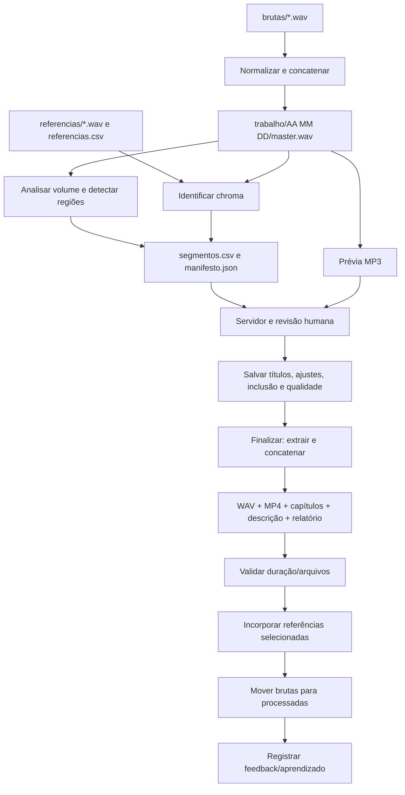

# Arquitetura e componentes — versão 3.1.3

## Componentes confirmados

| Componente | Responsabilidade | Interface principal |
|---|---|---|
| `Editor de Ensaios.vbs` | Lançador Windows sem terminal permanente | Inicializa o serviço local; instala ambiente se necessário |
| `instalar.bat` | Cria `.venv` isolado e instala dependências Python | `requirements.txt` |
| `revisao_web.py` | Servidor HTTP local, estado do ensaio, operações de revisão e subprocessos | `http://127.0.0.1:<porta>/`, endpoints `/api/*` |
| `interface.html`, `.css`, `.js` | Interface: timeline, formulário, dividir/unir, salvar, análise/finalização | HTTP/JSON + prévias MP3 |
| `ensaio.py` | Pipeline de análise de áudio, identificação, finalização, referências, compatibilidade com revisões | Subcomandos `analisar`, `finalizar`, `preparar-referencias`, `importar-referencias` (nomes legados devem ser verificados contra `--help`) |
| `config.json` | Parâmetros técnicos e caminhos | Lido por `ensaio.py` e servidor |
| FFmpeg / FFprobe | Normalização, extração, transcodificação, renderização e duração | Subprocessos locais |
| `numpy`, `soundfile`, `cffi` | Análise dos sinais, assinaturas, suporte WAV | `.venv` |

**Nota:** O editor tem serviço local HTTP, não é uma aplicação web hospedada na internet. Operações alteram arquivos no disco do usuário. O servidor usa `ThreadingHTTPServer` e controles de exclusão de subprocessos em `AppState._start_subprocess()`.

## Fluxo de dados

O diagrama representa a **ordem do código** e não garante atomicidade da transação. Atualmente a inserção de referências e a movimentação dos brutos podem ocorrer após publicação de arquivos finais, sem rollback integral.

## Dependências e fronteiras
- `ensaio.Config`: configura raiz, diretórios, limiares, codificação, parâmetros de reconhecimento e FFmpeg.
- `ensaio.Segment`: modelo interno de faixa. Persistência por CSV e campos de identificação.
- `revisao_web.AppState`: lê/grava revisão, inicia subprocessos, divide/une, refaz reconhecimento, monitora status e grava feedback.
- `revisao_web.Handler`: mapeia requisições para `AppState`; suporta HTTP Range em MP3, necessário para buscar posições da timeline.
- `revisao_web.Server`: `ThreadingHTTPServer` local; o bloqueio de operação longa é aplicado a subprocessos, não a todas as mutações de revisão.

## Endpoints confirmados
- GET `/`, `/interface.js`, `/interface.css`, `/logo`, `/audio/<arquivo>`.
- GET `/api/estado`, `/api/dados`, `/api/status`.
- POST `/api/analisar`, `/api/identificar`, `/api/salvar`, `/api/finalizar`, `/api/dividir`, `/api/unir`, `/api/encerrar`.

## Pontos de acoplamento relevantes
1. `manifesto.json` armazena caminhos absolutos; a v3.1.3 introduziu `repair_manifest_paths()` durante finalização e busca do master. O formato continua dependente de caminho.
2. Análise salva **um único estado de revisão ativa** em `_sistema/revisao`, com arquivos históricos em subpastas. Não é arquitetura multiensaio independente.
3. Mudanças estruturais reescrevem `segmentos.csv` e regeneram todas as prévias MP3.
4. `identificacoes.jsonl` influencia os limiares de reconhecimento, mas só registra correções após finalização bem-sucedida e polling do status da interface.